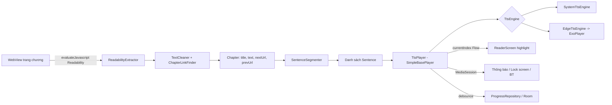

# TTS Browser — Kiến trúc & Công nghệ

## 1. Tech stack

| Lớp | Lựa chọn | Lý do |
|-----|----------|-------|
| Ngôn ngữ | Kotlin 2.x | Native, coroutines/Flow |
| UI | Jetpack Compose + Material 3, Navigation Compose | UI khai báo, dễ làm highlight/auto-scroll |
| Web | Android `WebView` + `androidx.webkit` | Có sẵn trên máy, hỗ trợ `evaluateJavascript`, dark mode |
| Trích nội dung | `Readability.js` (Mozilla) bundle trong `assets/` | Thuật toán reader mode của Firefox, chạy tốt trên đa số trang |
| TTS offline | `android.speech.tts.TextToSpeech` | Miễn phí, offline, dùng engine người dùng đã cài (Google TTS…) |
| TTS online | Edge TTS qua WebSocket (OkHttp) | Giọng neural vi-VN chất lượng cao, miễn phí |
| Phát audio Edge | Media3 ExoPlayer | Phát MP3 chunk, gapless |
| Phát nền | Media3 `MediaSessionService` + `SimpleBasePlayer` | Thông báo, màn hình khóa, tai nghe — chuẩn Android |
| Lưu trữ | Room (thư viện, tiến độ, lịch sử) + DataStore Preferences (cài đặt) | Chuẩn Jetpack |
| DI | Manual DI (`AppContainer`) | Dự án nhỏ, tránh overhead Hilt (KISS) |
| Build | AGP 9.4.1 (built-in Kotlin), Gradle 9.8.2, Kotlin 2.4.21, Kotlin DSL + version catalog, JDK 21, compileSdk 37, targetSdk 36, minSdk 26 | Chuẩn mới |
| Test | JUnit5/JUnit4, Turbine, Robolectric (logic), Compose UI test (vài màn chính) | |

## 2. Sơ đồ module (single-module, chia package)

```
app/src/main/java/com/trangnx/ttsbrowser/
├── ui/
│   ├── browser/       BrowserScreen, BrowserViewModel, WebView wrapper
│   ├── reader/        ReaderScreen (highlight câu), ReaderViewModel
│   ├── library/       LibraryScreen, LibraryViewModel
│   ├── settings/      SettingsScreen (engine, giọng, tốc độ, giao diện)
│   └── player/        MiniPlayerBar, SleepTimerSheet
├── extraction/        ReadabilityExtractor, ChapterLinkFinder, TextCleaner, HeadlessPageLoader, ElementPicker (chọn vùng thủ công)
├── text/              SentenceSegmenter
├── tts/
│   ├── TtsEngine.kt          interface chung
│   ├── system/               SystemTtsEngine
│   └── edge/                 EdgeTtsEngine, EdgeTtsClient (WebSocket), EdgeTokenGenerator
├── playback/          PlaybackService (MediaSessionService), TtsPlayer (SimpleBasePlayer), SleepTimer, AudioFocusHandler
├── data/
│   ├── db/            AppDatabase, entities, DAOs
│   ├── settings/      SettingsRepository (DataStore)
│   └── repo/          LibraryRepository, ProgressRepository
└── di/                AppContainer
```

## 3. Luồng dữ liệu



## 4. Thành phần chính

### TtsEngine (interface)
```kotlin
interface TtsEngine {
    val events: Flow<TtsEvent>          // Started(index), Done(index), Error(index, cause)
    suspend fun init(): Result<Unit>
    fun speak(sentences: List<Sentence>, fromIndex: Int)
    fun pause(); fun resume(); fun stop()
    fun setRate(rate: Float); fun setPitch(pitch: Float)
    suspend fun voices(): List<VoiceInfo>
    fun release()
}
```
- **SystemTtsEngine:** queue từng câu với `QUEUE_ADD`, `utteranceId = index`; `UtteranceProgressListener.onStart` → `Started(index)`. Pause = `stop()` + nhớ index (TTS hệ thống không có pause thật). Đặt `AudioAttributes(USAGE_MEDIA, CONTENT_TYPE_SPEECH)`.
- **EdgeTtsEngine:** mỗi câu → SSML (voice, rate, pitch) → WebSocket `speech.platform.bing.com/.../readaloud/edge/v1` → nhận MP3 → đưa vào ExoPlayer playlist (mỗi câu 1 `MediaItem` từ byte array). Prefetch N=3 câu, cache LRU theo hash(text+voice+rate). Token `Sec-MS-GEC` sinh theo timestamp (tham khảo thư viện Python `edge-tts`).

### TtsPlayer (SimpleBasePlayer)
- Bọc engine thành `Player` của Media3 → MediaSession tự xử lý thông báo, lock screen, nút tai nghe.
- `seekToNext/Previous` = câu sau/trước; custom command "Chương sau", "Hẹn giờ".
- Expose `StateFlow<PlaybackUiState>` (index câu, đang phát, chương) cho UI.

### HeadlessPageLoader
- WebView không gắn vào UI để tải `nextUrl` khi bấm "Chương sau" từ thông báo (app ở nền). Cùng script Readability. Timeout 15s.

## 5. Dữ liệu (Room)

| Bảng | Cột chính |
|------|-----------|
| `book` | id, title, host, coverUrl?, currentChapterUrl, createdAt, updatedAt |
| `chapter` | id, bookId, url (unique), title, prevUrl?, nextUrl?, contentText?, fetchedAt |
| `progress` | bookId (PK), chapterUrl, sentenceIndex, charOffset, updatedAt |
| `history` | id, url, title, visitedAt |
| `bookmark` | id, url, title, createdAt |
| `site_rule` | host (PK), contentSelector, updatedAt — selector từ chọn vùng thủ công |

DataStore: `engine`, `systemVoice`, `edgeVoice`, `rate`, `pitch`, `fontSize`, `readerTheme`, `defaultSleepMinutes`.

## 6. Quyền & Manifest

- `INTERNET`, `FOREGROUND_SERVICE`, `FOREGROUND_SERVICE_MEDIA_PLAYBACK`, `POST_NOTIFICATIONS` (Android 13+), `WAKE_LOCK` (ExoPlayer), `REQUEST_IGNORE_BATTERY_OPTIMIZATIONS` (sideload, không vướng chính sách Play).
- `<service android:name=".playback.PlaybackService" android:foregroundServiceType="mediaPlayback" android:exported="true">` với intent-filter `androidx.media3.session.MediaSessionService`.
- `<queries>` intent `android.intent.action.TTS_SERVICE` để liệt kê engine TTS (Android 11+).

## 7. Bảo mật

- WebView: `javaScriptEnabled=true` (cần cho trang), **không** dùng `addJavascriptInterface` cho trang bên ngoài — chỉ nhận kết quả qua callback `evaluateJavascript`.
- Không cho phép `file://` access, tắt `allowUniversalAccessFromFileURLs`.
- Không lưu cookie/mật khẩu ngoài cơ chế mặc định của WebView.
