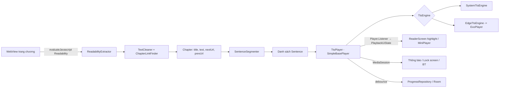

# TTS Browser — Kiến trúc & Công nghệ

## 1. Tech stack

| Lớp | Lựa chọn | Lý do |
|-----|----------|-------|
| Ngôn ngữ | Kotlin 2.x | Native, coroutines/Flow |
| UI | Jetpack Compose + Material 3, Navigation Compose | UI khai báo, dễ làm highlight/auto-scroll |
| Web | Android `WebView` + `androidx.webkit` | Có sẵn trên máy, hỗ trợ `evaluateJavascript`, dark mode |
| Trích nội dung | `Readability.js` (Mozilla) bundle trong `assets/` | Thuật toán reader mode của Firefox, chạy tốt trên đa số trang |
| TTS offline | `android.speech.tts.TextToSpeech` | Miễn phí, offline, dùng engine người dùng đã cài (Google TTS…) |
| TTS online | Edge TTS qua WebSocket (OkHttp) | Giọng neural vi-VN chất lượng cao, miễn phí |
| Phát audio Edge | Media3 ExoPlayer | Playlist MP3 theo câu, tiền tải giới hạn trong RAM |
| Phát nền | Media3 `MediaSessionService` + `SimpleBasePlayer` | Thông báo, màn hình khóa, tai nghe — chuẩn Android |
| Lưu trữ | Room (thư viện, tiến độ, lịch sử) + DataStore Preferences (cài đặt) | Chuẩn Jetpack |
| DI | Manual DI (`AppContainer`) | Dự án nhỏ, tránh overhead Hilt (KISS) |
| Build | AGP 9.4.1 (built-in Kotlin), Gradle 9.8.2, Kotlin 2.4.21, Kotlin DSL + version catalog, JDK 21, compileSdk 37, targetSdk 36, minSdk 26 | Chuẩn mới |
| Test | JUnit5/JUnit4, Turbine, Robolectric (logic), Compose UI test (vài màn chính) | |

## 2. Sơ đồ module (single-module, chia package)

```
app/src/main/java/com/trangnx/ttsbrowser/
├── ui/
│   ├── browser/       BrowserScreen, BrowserViewModel, BrowserWebView (WebView giữ ở AppNavHost, sống qua đổi tab), BrowserAddressBar, PageLinkList, UrlInputResolver
│   ├── reader/        ReaderScreen, ReaderViewModel, ReaderText (highlight, chạm câu, tự cuộn), ReaderControls, ReaderDisplaySheet (phông, cỡ chữ, màu nền/chữ), ReaderColors, ReaderFonts, ReaderSwatches, SentenceSpans
│   ├── common/        AutoHideBars (BarsVisibility: ẩn thanh khi cuộn xuống, hiện khi cuộn lên; dùng cho trình duyệt và reader)
│   ├── library/       LibraryScreen, LibraryViewModel (mở truyện đã lưu bằng HeadlessPageLoader)
│   ├── settings/      SettingsScreen, SettingsViewModel (tự ẩn thanh công cụ, nguồn giọng, hai giọng Edge, tốc độ/cao độ)
│   └── player/        MiniPlayerBar, PlayPauseButton, SleepTimerSheet
├── extraction/        ReadabilityExtractor, ChapterLinkFinder, TextCleaner, JsResult/RawPage, PageScriptRunner, PageWebViewSettings, ElementPicker (chọn vùng thủ công), HeadlessPageLoader
├── text/              SentenceSegmenter, Sentence, ResumePosition (khôi phục câu theo charOffset), BookTitleSuggester
├── tts/
│   ├── TtsEngine.kt          interface chung (+ TtsEvent, TtsInitException)
│   ├── FallbackTtsEngine.kt  Edge lỗi → hệ thống, đọc lại câu hiện tại
│   ├── system/               SystemTtsEngine, UtteranceId
│   └── edge/                 EdgeTtsEngine, EdgeTtsClient (WebSocket), EdgeProtocol, EdgeTokenGenerator, AudioMemoryCache
├── playback/          PlaybackService (MediaSessionService), PlaybackConnection (MediaController, state cho UI), PlaybackUiState, TtsPlayer (SimpleBasePlayer), SpeechDriver, SentencePlaylist, AudioFocusHandler, BecomingNoisyReceiver, SleepTimer, ProgressTracker, AdjacentChapterLoader
├── data/
│   ├── db/            AppDatabase, entities (Book, Progress, History, Bookmark, SiteRule), DAOs
│   ├── settings/      SettingsRepository (DataStore: cỡ chữ, phông, nền và màu chữ reader, tự ẩn thanh, engine/giọng, tốc độ/cao độ riêng mỗi engine)
│   └── repo/          BrowsingRepository (history, bookmark), SiteRuleRepository, LibraryRepository (truyện + tiến độ)
└── di/                AppContainer
```

## 3. Luồng dữ liệu



## 4. Thành phần chính

### TtsEngine (interface)
```kotlin
interface TtsEngine {
    val events: Flow<TtsEvent>          // Started(index), Done(index), Error(index, code) — chỉ của lần speak hiện tại
    suspend fun init(): Result<Unit>    // lỗi: TtsInitException(EngineUnavailable | LanguageUnsupported)
    fun speak(sentences: List<Sentence>, fromIndex: Int)
    fun stop()
    fun setRate(rate: Float); fun setPitch(pitch: Float)   // áp dụng từ lần speak sau
    fun setVolume(volume: Float) {}                      // Edge áp ngay, system không hỗ trợ
    fun release()
}
```
Không có pause/resume trong interface: player pause = `stop()` + nhớ index, resume = `speak` từ câu hiện tại. Hai giọng Edge cho phép trong Settings là `vi-VN-HoaiMyNeural` và `vi-VN-NamMinhNeural`; system dùng giọng mặc định tiếng Việt của thiết bị.
- **SystemTtsEngine:** `setLanguage(vi-VN)` (thiếu dữ liệu → lỗi), queue cuốn chiếu 5 câu với `QUEUE_ADD` (nạp thêm ở mỗi `onDone`), `speak()` bị từ chối → `Failed`, `utteranceId = "<generation>:<index>"`; generation tăng mỗi `speak/stop`, event lọc theo generation ở collector (main thread) → bỏ callback trễ. Đặt `AudioAttributes(USAGE_MEDIA, CONTENT_TYPE_SPEECH)`.
- **EdgeTtsEngine:** mỗi câu → SSML escape XML (voice allowlist, rate, pitch) → `EdgeTtsClient` → MP3 → ExoPlayer playlist (`ByteArrayDataSource`, mỗi câu 1 nguồn). Cửa sổ tiền tải tối đa 3 câu gồm câu hiện tại; cache LRU RAM 4 MiB theo `(text, voice, rate, pitch)`, không lưu audio xuống đĩa. Nguồn đã phát bị gỡ cả khi queue thiếu dữ liệu rồi phát tiếp. `stop/seek/release` hủy coroutine/request, giải phóng ExoPlayer và lọc callback theo generation. ExoPlayer không tự xin audio focus; `TtsPlayer` quản lý chung. Wake mode local chỉ dùng trong thời gian phát.
- **EdgeTtsClient:** mỗi câu một WebSocket TLS tới `speech.platform.bing.com/.../readaloud/edge/v1`. Timeout toàn yêu cầu 25s, SSML tối đa 8 KiB, audio tối đa 2 MiB/câu; không có audio hoặc framing lỗi → failure. HTTP 403 có `Date` → hiệu chỉnh lệch đồng hồ rồi thử lại một lần. Timeout yêu cầu thành `IOException`; thao tác pause/seek vẫn truyền cancellation và hủy socket.
- **EdgeTokenGenerator:** `Sec-MS-GEC` v2 theo mốc Windows ticks làm tròn 5 phút, biến thể SHA-256 + CS64, đối chiếu vector độc lập từ upstream `edge-tts`. Port từ mã LGPL-3.0-only, attribution tại đầu file và bản license bundle trong `assets/licenses/edge-tts-LICENSE.txt`, `GPL-3.0.txt`. Endpoint không chính thức có thể đổi giao thức.
- **FallbackTtsEngine:** một lần thử Edge trong mỗi vòng đời engine; khi init hoặc phát lỗi, release Edge rồi init system (timeout 15s), đọc lại câu hiện tại với tốc độ/cao độ đang chọn. Giữ system qua pause/seek; lần tạo engine mới có thể thử Edge lại. Thông báo một lần: snackbar khi Activity STARTED, Toast khi nền; lỗi khởi tạo system vẫn báo lỗi phát.

### TtsPlayer (SimpleBasePlayer) — Phase 4
- Bọc engine thành `Player` của Media3 → MediaSession tự xử lý thông báo, lock screen, nút tai nghe.
- **Mỗi câu = 1 MediaItem** (`buildSentencePlaylist`, title = tên chương, artist = "Câu i/n") → `seekToNext/Previous` = câu sau/trước, `seekTo(index)` = nhảy câu. UI đọc index câu từ `currentMediaItemIndex` qua `MediaController` (không cần StateFlow riêng).
- Singleton trong `AppContainer`; UI nạp chương bằng `setChapter()` rồi `PlaybackConnection` gọi `MediaController.play()` (bind `PlaybackService`, Media3 tự lên foreground khi phát). Service `onDestroy` → `player.stop()`, không release player.
- `SpeechDriver`: tạo engine khi phát lần đầu (state BUFFERING, init timeout 15s), giải phóng khi stop/lỗi/hết chương; lỗi 1 câu bỏ qua, 3 lỗi liên tiếp hoặc 90s không callback → `playerError`.
- `PlaybackConnection.release()` khi task bị gỡ (`onTaskRemoved`) để service dừng được.
- Audio focus (`AudioFocusHandler`, pause khi bị duck), mất focus tạm → suppression `TRANSIENT_AUDIO_FOCUS_LOSS`; `BecomingNoisyReceiver` → pause.
- Phase 6: nút trước/sau trên thông báo, màn hình khoá, tai nghe chuyển chương (`ChapterSkippingPlayer`, ForwardingPlayer của session; nút tua câu trong app seek theo index) → `AdjacentChapterLoader`.
- Phase 7: `configureSpeech(rate, pitch, replaceEngine)` áp cài đặt ngay; đổi nguồn/giọng release engine cũ rồi tiếp tục từ câu hiện tại, giữ ý định play/pause. `setSpeechVolume` qua `SpeechDriver` để fade Edge mà không đổi âm lượng hệ thống.

### Reader UI — Phase 5
- FAB "Đọc" → `ExtractionViewModel` trích → `openReader` (collect ở `AppNavHost`) → `ReaderViewModel.show()` → route `reader` (toàn màn hình, trên các tab). Chương chỉ vào player (`PlaybackConnection.load()`) khi bấm Play / chạm câu, hoặc khi chuyển chương từ reader lúc đang phát.
- `PlaybackConnection.state` (`PlaybackUiState`) lấy từ `Player.Listener` của `TtsPlayer`; lệnh (play/pause, chạm câu = `seekTo(i)` + `play`, câu trước/sau) qua `MediaController`.
- Mỗi đoạn 1 item `LazyColumn`, mỗi câu 1 `LinkAnnotation.Clickable`; câu hiện tại tô nền `primaryContainer`; tự cuộn theo `TextLayoutResult`, tắt khi người dùng kéo.
- Reader gửi `PageRequest` (Pick / ClearRule / ExtractWhenLoaded) cho `ExtractionViewModel` (scope Activity), chạy khi tab trình duyệt hiện lại.
- Cài đặt reader trong DataStore; `AppContainer` áp tốc độ đã lưu vào `TtsPlayer` từ lúc tạo. Controller ngoài (thông báo, Wear…) không được đổi tốc độ.

### Settings — Phase 7
- `SettingsViewModel` đọc `speechSettings` bằng lifecycle state; UI chọn System/Edge, hai giọng Việt, tốc độ 0.5–3.0 và cao độ 0.5–2.0. Slider chỉ lưu khi nhả tay để tránh đọc lại câu liên tục; lỗi lưu hiện snackbar.
- `readerSettings.rate` phản ánh engine được chọn; tốc độ trong sheet reader và Settings cùng một nguồn dữ liệu. `rate` cũ được giữ cho system, Edge có tốc độ riêng. Giá trị không hữu hạn/không hợp lệ được đưa về mặc định hoặc giới hạn an toàn.
- Chỉ khi bật Edge mới gửi các câu đang đọc/tiền tải tới Microsoft. UI giải thích yêu cầu mạng và dữ liệu gửi đi; system là mặc định.

### Trích nội dung (Phase 3)
- `assets/js/`: `Readability.js` (Mozilla 0.6.0, Apache-2.0), `extract-page.js`, `element-picker.js`.
- Mỗi lần trích: nối `Readability.js` + `extract-page.js` vào một IIFE rồi `evaluateJavascript` → chuỗi JSON (`RawPage`): text (giữ ngắt đoạn), tiêu đề, ứng viên link. Kotlin làm sạch (`TextCleaner`), chấm điểm link (`ChapterLinkFinder`), tách câu (`SentenceSegmenter`) → `Chapter` + `List<Sentence>`.
- Thứ tự: selector trong `site_rule` theo host → Readability. Nội dung < 200 ký tự → lỗi, mời chọn vùng thủ công.
- `element-picker.js` cài `window.__ttsPicker`; Kotlin gọi `status/parent/selector/stop` qua `evaluateJavascript` (poll 500ms), không dùng JS bridge.

### HeadlessPageLoader — Phase 6
- WebView không gắn vào UI (tạo bằng application context, hủy sau khi xong): tải URL, chờ `onPageFinished` rồi 500ms không có lần tải nào nữa (redirect, trang chờ Cloudflare), rồi chạy `ReadabilityExtractor` như tab trình duyệt (cùng site_rule, cùng cookie). Timeout tải 15s; lỗi tải / timeout → `Reason.LoadFailed`.
- Dùng bởi `AdjacentChapterLoader` (chương trước/sau từ media player → `load` + `playFrom(0)`, một lần một lúc) và `LibraryViewModel` (mở truyện đã lưu).
- Cấu hình WebView chung (`PageWebViewSettings`): JS + DOM storage bật, tắt truy cập file/content; chặn scheme khác http/https.

### Thư viện & tiến độ — Phase 6
- Không lưu nội dung chương: mở lại truyện = tải lại `progress.chapterUrl`, đặt câu theo `resumeIndex(sentenceIndex, charOffset)` (khớp `start` thì giữ chỉ số, không thì câu chứa `charOffset`), nạp vào player và pause. Chương đang nằm trong player thì giữ vị trí sống.
- Chương thuộc truyện nào = truyện có `progress.chapterUrl` ∈ {url, prevUrl, nextUrl} của chương (`LibraryRepository.bookOf`, Flow Room) → đọc tiếp chương liền kề vẫn thuộc cùng truyện, không cần trạng thái "truyện đang đọc". "Lưu truyện" trùng (host, tên) thì cập nhật truyện cũ.
- `ProgressTracker` (app scope, khởi động cùng `AppContainer`): ghi khi truyện, chương đang nạp và chỉ số câu cùng một chương; tối đa 1 lần/2s, ngay khi pause/hết chương, và khi `PlaybackService` bị gỡ/hủy. `PlaybackConnection.load` đặt `loaded` trước khi đổi hàng đợi để chỉ số câu của chương mới không bị gán cho truyện của chương cũ.
- `SleepTimer` (app scope, `elapsedRealtime`, kiểm tra mỗi 15s): 15/30/45/60 phút → pause player; "hết chương" → gỡ khi chương đọc xong và chặn tự chuyển chương (`onChapterEnded()` trả true). Không có timer này, `AppContainer` gọi `AdjacentChapterLoader.openNext` khi player kết thúc chương: tự đọc tiếp chương sau, chương cuối thì dừng. Phase 7 giảm âm lượng Edge tuyến tính trong 15 giây cuối, kiểm tra mỗi giây; khi hủy hoặc hết giờ khôi phục volume 1.0 (pause trước khi khôi phục). System không hỗ trợ thay đổi âm lượng các câu đã xếp hàng nên giữ hành vi cũ.

## 5. Dữ liệu (Room)

| Bảng | Cột chính |
|------|-----------|
| `book` | id, title, host, createdAt, updatedAt — unique (host, title); `updatedAt` = lần đọc gần nhất (sắp xếp thư viện) |
| `progress` | bookId (PK, FK → book, xóa theo), chapterUrl (index), chapterTitle, sentenceIndex, charOffset, updatedAt |
| `history` | id, url, title, visitedAt |
| `bookmark` | id, url, title, createdAt |
| `site_rule` | host (PK), contentSelector, updatedAt — selector từ chọn vùng thủ công |

Schema Room export ra `app/schemas/` (Room Gradle plugin); thêm bảng ở phase sau bằng AutoMigration. Phase 2 có `history`, `bookmark` (v1); Phase 3 thêm `site_rule` (v2); Phase 6 thêm `book`, `progress` (v3). Bảng `chapter` (cache nội dung) và `book.coverUrl`/`currentChapterUrl` chưa làm: chưa có đọc offline, vị trí nằm ở `progress`.

DataStore: `engine`, `edgeVoice`, `rate` (system, giữ key cũ), `edgeRate`, `systemPitch`, `edgePitch`, `fontSize`, `readerTheme`. `systemVoice` chưa có lựa chọn riêng; hẹn giờ không có mặc định lưu.

## 6. Quyền & Manifest

- Đã có (Phase 4): `INTERNET`, `FOREGROUND_SERVICE`, `FOREGROUND_SERVICE_MEDIA_PLAYBACK`. Thông báo media session được miễn `POST_NOTIFICATIONS` (Android 13+) nên không xin.
- Phase 7: `WAKE_LOCK` cho ExoPlayer local wake mode. Sau: `REQUEST_IGNORE_BATTERY_OPTIMIZATIONS` (Phase 8, sideload).
- `<service android:name=".playback.PlaybackService" android:foregroundServiceType="mediaPlayback" android:exported="true">` với intent-filter `androidx.media3.session.MediaSessionService`.
- `<queries>` intent `android.intent.action.TTS_SERVICE` để liệt kê engine TTS (Android 11+).

## 7. Bảo mật

- WebView: `javaScriptEnabled=true` (cần cho trang), **không** dùng `addJavascriptInterface` cho trang bên ngoài — chỉ nhận kết quả qua callback `evaluateJavascript`.
- Không cho phép `file://` access, tắt `allowUniversalAccessFromFileURLs`.
- Không lưu cookie/mật khẩu ngoài cơ chế mặc định của WebView.
- Edge chỉ nhận văn bản câu và thông số giọng khi được bật; không gửi URL trang/cookie WebView, không ghi log văn bản. Audio cache chỉ trong RAM, bị xóa khi release engine.

## 8. Kiểm tra còn lại

- Phase 7: kiểm tra cuối `assembleDebug`, 78 unit tests và `lintDebug` pass; lint còn 3 warning baseline (`OldTargetApi`, `ExportedService`, `ObsoleteSdkInt`). Live endpoint trả 11.232 byte MP3 cho câu tổng hợp. Xiaomi 13 cài/mở app, cài đặt Edge Nam Minh tồn tại qua force-stop/relaunch, không crash. Giọng thật, pause/seek, mất mạng/fallback, chuyển engine khi đang đọc, phát nền và sleep fade chưa xác nhận đầy đủ.
- Phase 8: kiểm tra lỗi sẵn có `SystemTtsEngine.queueMore`: khi `speak()` từ chối đồng bộ, `Failed` được emit rồi tăng generation khiến event bị lọc bỏ; watchdog có thể chỉ báo lỗi sau 90s.
